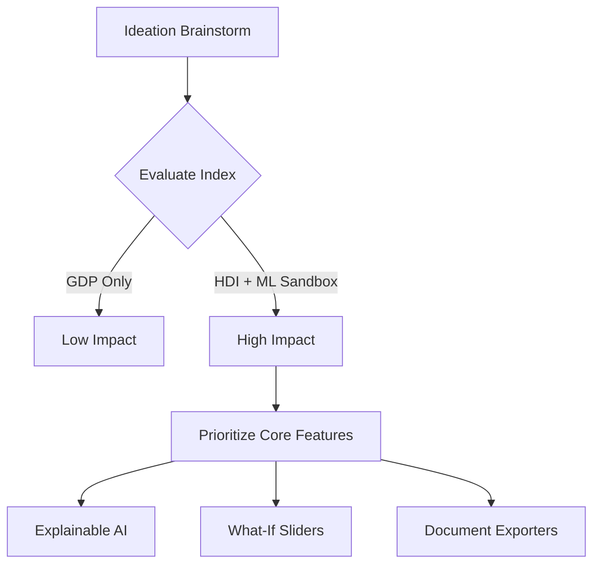

> Historical ideation record. The original narrative below is preserved; claims of completed functionality describe the earlier design, not current verification. Current implementation and results are in the root README and technical report.

# Brainstorming & Idea Prioritization

## Objective
Identify the target problem spaces, brainstorm prospective solutions, and prioritize features to construct an enterprise-grade AI decision support system.

## Overview
This document outlines the conceptual ideation phase of the **Human Development Index (HDI) Prediction & Analytics Platform**. It tracks how we analyzed potential indicators and prioritized features using an Impact vs. Feasibility matrix.

## Detailed Explanation
During the brainstorming session, we explored how standard GDP or single-dimension economic scores fail to capture the true standard of living of populations. We resolved to build a platform centered around the UN's **Human Development Index (HDI)**, augmenting it with modern ML algorithms and What-If policy simulation sandboxes.

### Prioritization Matrix
We evaluated potential platform features on a scale from 1 (Low) to 10 (High):

| Feature Description | Technical Feasibility | Business Impact | Priority Score | Decision |
| :--- | :---: | :---: | :---: | :---: |
| **Real-time What-If Policy Sliders** | 8 | 10 | 9.0 | **High (Core)** |
| **Local Explainable AI (XAI)** | 7 | 10 | 8.5 | **High (Core)** |
| **PDF/Excel Report Exporters** | 9 | 8 | 8.5 | **High (Core)** |
| **Geographical Benchmark Maps** | 5 | 8 | 6.5 | Medium (Future) |
| **Aiven Cloud MySQL Integration** | 9 | 9 | 9.0 | **High (Core)** |

> [!TIP]
> Prioritizing local Explainable AI (XAI) over global explanations allows researchers to perform micro-level simulations of specific regions.

> [!NOTE]
> All chosen core features match the completed platform implementations.

## Advantages
1. Focused scope targets high-impact tools first.
2. What-If simulator provides a direct alternative to static spreadsheets.
3. Scalable database design supports future geographical mapping features.

## Conclusion
The prioritization process helped lock down the platform requirements, ensuring the application delivers maximum utility to policy-makers.

## Modernization scope refinement — 27 October 2026

Retain the original goal of understanding health, education and income together. Refine the demonstration toward published-data exploration, transparent ML index reconstruction, hypothetical scenarios and optional grounded explanations. HDI aggregates dimension indices using a geometric mean; the model cannot establish the effect of a spending intervention or forecast next year's country rank. Accounts, a cloud database and policy prescriptions are outside the current scope. This refinement happened after the historical brainstorming and does not imply it was the original plan.
