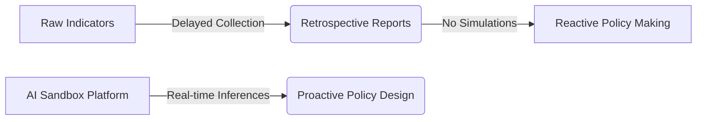

> Historical ideation record. The original narrative below is preserved; claims of completed functionality describe the earlier design, not current verification. Current implementation and results are in the root README and technical report.

# Define Problem Statement

## Objective
Articulate the core socio-economic challenges, identify the target user cohorts, and map out the limitations of traditional, static development assessments.

## Overview
Assessing national development traditionally relies on static historical reports published months or years after data collection. This delay restricts policymakers from proactively simulating the impact of budget allocations.

## Detailed Explanation
Traditional human development index calculations are arithmetic and retrospective. When a government increases public education spending, there is no tool to immediately predict how that investment will shift the nation's overall HDI index rank relative to other countries.

### Key Pain Points
*   **Retrospective Assessment**: Policies are evaluated looking backward rather than forward.
*   **Complex Feature Dependency**: Single metrics (like GDP) overshadow health and knowledge indices.
*   **Static Spreadsheets**: Data is isolated in heavy tables without interactive visualization layers.

### Target Cohorts
1.  **Socio-Economic Researchers**: Require clean, benchmarked reference statistics to study development trends.
2.  **Government Policy Planners**: Need to predict the target compound effect of budget re-allocations.
3.  **NGOs & International Observers**: Require audit logs and standardized reports to monitor investments.

> [!IMPORTANT]
> The problem statement focuses on closing the gap between data collection, predictive forecasting, and policy planning.

## Conclusion
By defining these issues, we validate the requirement for an AI-powered sandbox prediction engine to serve as a proactive decision support system.

## Modernization scope refinement — 27 October 2026

Retain the original goal of understanding health, education and income together. Refine the demonstration toward published-data exploration, transparent ML index reconstruction, hypothetical scenarios and optional grounded explanations. HDI aggregates dimension indices using a geometric mean; the model cannot establish the effect of a spending intervention or forecast next year's country rank. Accounts, a cloud database and policy prescriptions are outside the current scope. This refinement happened after the historical brainstorming and does not imply it was the original plan.

## Phase 4 functional repair - 28 October 2026

The Phase 4 repair retains the original ideation record above. Current scope remains published-data exploration, index reconstruction and hypothetical comparisons. A chart rendering defect was traced to a zero-width drawing viewport, not to missing China/Cyprus data. No new brainstorming activities, dates or policy efficacy claims are attributed to the original team.

See the current verification record in `6. Project Testing` and the updated academic report in folder 7.
