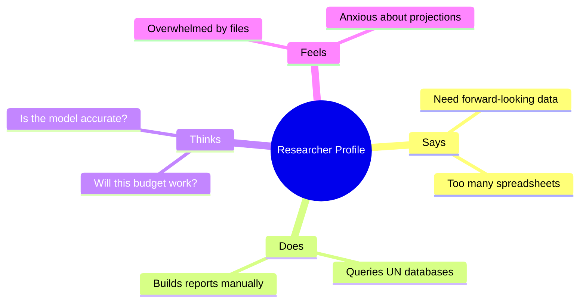

> Historical ideation record. The original narrative below is preserved; claims of completed functionality describe the earlier design, not current verification. Current implementation and results are in the root README and technical report.

# Empathy Map: Socio-Economic Policy Researcher

## Objective
Empathize with our primary user cohort to align UI/UX designs with their workflows, needs, and pain points.

## Overview
This empathy map visualizes what a Policy Researcher **says**, **does**, **thinks**, and **feels** when compiling development reports.

---

---

### Map Details

| Dimension | Observations |
| :--- | :--- |
| **SAYS** | "I need to model how a 2% increase in health expenditure will affect our HDI score next year." |
| **DOES** | Copies data between Excel tables, runs manual statistics, writes PDF reports. |
| **THINKS** | *How can I prove to the board that these budget adjustments will shift our index ranking?* |
| **FEELS** | Frustrated by delayed UN indices; anxious about manual computation errors. |

### Pains & Gains
*   **Pains**: Delayed data, lack of interactive simulations, complex scripting required for ML.
*   **Gains**: 1-click PDF/Excel reports exports, real-time feedback loop, clear explanation of predictive drivers (XAI).

> [!TIP]
> Highlighting local attributions in green/red bars helps researchers quickly scan visual results without parsing complex regression outputs.

## Conclusion
Aligning platform features with this empathy profile drove the design of our dual-pane prediction form and slide sandbox.

## Modernization scope refinement — 27 October 2026

Retain the original goal of understanding health, education and income together. Refine the demonstration toward published-data exploration, transparent ML index reconstruction, hypothetical scenarios and optional grounded explanations. HDI aggregates dimension indices using a geometric mean; the model cannot establish the effect of a spending intervention or forecast next year's country rank. Accounts, a cloud database and policy prescriptions are outside the current scope. This refinement happened after the historical brainstorming and does not imply it was the original plan.
