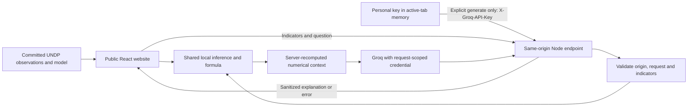

# Current data flow

The existing offline training flow remains: pinned CSV -> complete country-years -> country-separated training/validation/test -> versioned model and data artifacts. Phase 3 does not rerun or modify it.

The key stays in browser memory until an explicit AI operation. The hosting endpoint receives it over HTTPS in production, uses it for that request and does not persist it. Key save/change/remove does not make a provider call. Theme preference is separate from credential state. See [current architecture](<../3. Project Design Phase/Solution Architecture.md>).

## Phase 4 functional repair - 28 October 2026

Trend rendering reads published history by ISO3, materializes every calendar year through the selected year, validates bounded numeric HDI values and leaves absent values null. ResponsiveContainer supplies the actual drawing width; a percentage max-width must not constrain its internal zero-width measurement wrapper. No data or model artifact is regenerated for a chart repair.

See the current verification record in `6. Project Testing` and the updated academic report in folder 7.
