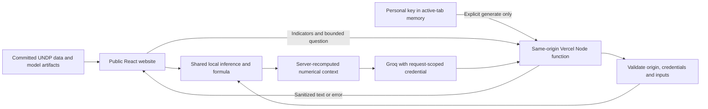

# Current system architecture

## Website and state boundaries

`src/App.tsx` owns route navigation and shared baseline/scenario state. `Navbar.tsx` renders the horizontal top navigation and compact mobile dropdown. Home, Explore Data, HDI Predictor, Scenarios and Methodology use centralized cyan light/dark tokens; the original `public/hdi-logo.svg` also serves as the favicon. A shared footer supplies the required creator attribution.

Page modules render analytics, prediction, comparisons, explanations and methodology. `components.tsx` supplies controls and result displays; `Trend.tsx` shares historical charts and exact-value tables. `Explanation.tsx` renders safe React text, emphasis and lists. `useReducedMotion.ts` coordinates optional chart motion with the CSS reduced-motion rules.

`shared/inference.mjs` remains responsible for schema, validation, thresholds, dimensions, direct formula, model inference and sensitivity. It is shared by the browser and optional API. No dataset, model, training or inference change is required by this presentation update.

## Personal-key boundary

`AIContext.tsx` holds a visitor's key in active-tab memory. `AISettings.tsx` provides a masked native dialog, show/hide, use/change/remove and connection status. Saving a key makes no network request and is not proof of valid Groq access. Refresh clears it. Credential state is not written to localStorage, sessionStorage, a database, URLs or analytics; theme preference remains separate.

Only an explicit explanation action in `Insights.tsx` sends `X-Groq-API-Key` to `/api/insights`. The hosting server receives the key and uses it only for that request to Groq. The notice tells visitors to enter keys only on trusted websites. Production uses HTTPS and requires an explicit exact HTTPS `APP_ORIGIN`; the loopback development origin is allowed locally.

Changing/removing a key aborts pending browser requests and clears displayed answers. It cannot retract a request already received upstream. The key is not a dependency of numerical inference, published-data exploration or scenario calculations.

## API boundary

`api/insights.mjs` retains method/content-type checks, a 4 KiB body limit, finite numeric bounds, a 1–500-character question, exact-origin checks, server-recomputed model evidence, a 15-second timeout, no-store responses and instance-local IP throttling. Keys are not stored in rate-limit buckets. Provider error bodies are not relayed; returned credential-like strings are redacted. Invalid credentials, quota/rate limits, timeout and unavailable-provider responses are handled separately.

The default provider model remains `openai/gpt-oss-20b`, configurable through server `GROQ_MODEL`. Public personal-key requests do not require an owner token. Optional owner-key fallback is disabled unless `ALLOW_OWNER_AI=true`; it additionally requires `GROQ_API_KEY` and a strong `AI_ACCESS_TOKEN` supplied in `X-AI-Access-Token` for every owner request, including locally. There is no public owner-code input. A supplied personal key takes priority and a provider failure does not silently use the owner key.

The limiter is process-local and resets on cold starts. It is not a distributed quota or proof of public load capacity.

## Data and training

The preserved training pipeline reads the pinned official CSV, excludes aggregate and incomplete rows, splits by country (outer seed 42, inner seed 43), applies log(GNI), selects by validation MAE, refits and exports the model/evaluation artifacts. No retraining was performed during cleanup. The selected model remains linear regression.

The explorer loads `public/data/explorer.json`, previously derived from the unchanged processed panel. Observed history remains distinct from model estimates; missing country/year records are not filled with current values. Historical presets transfer their source year into the predictor. The scenario baseline is the last committed valid calculation, while drafts remain separately editable.

## Routing, deployment and failure states

Hash routes support static-host refresh. `#insights` remains a compatibility route; AI is primarily contextual within predictor/scenario results. Invalid inputs prevent calculation, dirty drafts identify stale results, model-load failure offers retry, empty filters show an empty state, and AI failures leave core features usable.

Local `scripts/dev.mjs` starts Vite and the API adapter; restart it after endpoint/environment changes. Vercel uses phase 8 as its root, `npm run build` and `dist`, plus the Node function. No database, login system or live Python service is introduced.

Current local verification is recorded in folder 6. Hosted Vercel behavior requires a separate deployment check.

## Phase 4 functional repair - 28 October 2026

Phase 4 changes only rendering, range mapping and bounded request validation. Each history includes all calendar years through the observation-year selection; null values remain gaps. Recharts owns its pixel-sized wrapper. Browser regression checks must assert a nonzero SVG viewport, because a valid path can exist inside an invisible zero-width SVG. Current verification is recorded separately in folder 6.

See the current verification record in `6. Project Testing` and the updated academic report in folder 7.

