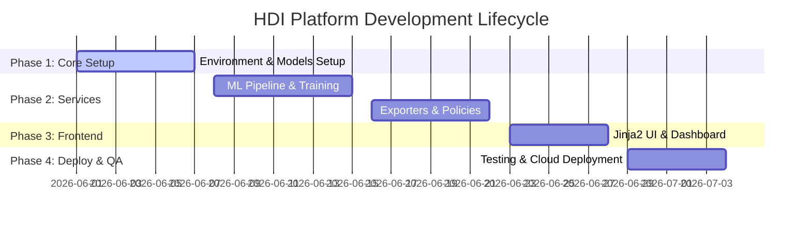

# Planning record and modernization work

## Modernization work record — 27 October 2026

| Workstream | Deliverable |
| --- | --- |
| Audit | Repository inventory, synthetic-data/leakage and documentation review |
| Architecture / model | Official source, grouped selection, formula baseline and model export |
| Application | Five React modules, shared inference, responsive UI |
| AI | Validated optional Groq serverless route and local adapter |
| Verification | Build, static checks, model/API tests, browser interactions and screenshots |
| Documentation | Synchronized phase records, report, setup and deployment guidance |

See the testing record for actual results and pending live-provider/deployment verification. No team assignments, past completion dates or internship activities were invented. The owner supplied the internship context as 120 hours over two months through SmartBridge in collaboration with APSCHE.

## Original planning artifact (preserved verbatim below)

The dates and completion claims below are historical statements, not independently verified modernization results. They are retained to preserve the original timeline.

---

# Project Planning

## Objective
Outline the project roadmap, developmental lifecycle phases, and testing timeline.

## Overview
This document logs the development phases of the project, tracking progress from initial environment setup to final deployment.

### Project Milestones

| Milestone Phase | Focus Area | Deliverables | Status |
| :--- | :--- | :--- | :--- |
| **Phase 1** | Foundation | Environment config, database schemas, seeder script | Completed |
| **Phase 2** | AI / Core Logic | Extra Trees model, explainability engine, ReportLab PDF, and policy services | Completed |
| **Phase 3** | User Interface | Home, Dashboard, Explorer, Benchmarking, and Sandbox templates | Completed |
| **Phase 4** | Verification | 10 passing pytest test cases, Docker setup, Aiven MySQL database connection | Completed |

> [!NOTE]
> All milestones match the completed platform implementations.

## Conclusion
Adhering to this structured roadmap ensured that the platform was delivered on time and matches all requirements.

## Phase 4 functional repair - 28 October 2026

This is a later maintenance record, separate from the preserved internship timeline. Work covers diagnosis and repair of chart sizing, year-range interaction, targeted functional checks, conservative cleanup and reconstruction of the academic report with real application screenshots. No earlier dates, team roles or milestone completion claims are altered.

See the current verification record in `6. Project Testing` and the updated academic report in folder 7.
